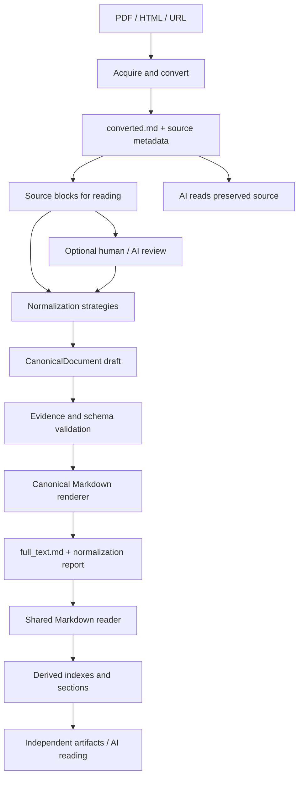

# PDF／HTML Reader 整合重構開發計畫

日期：2026-10-26  
最新 CLI 決策：依使用者明確要求，已移除 `main.py pdf`／`main.py url` 子命令與 `src/pdf_reader_main.py`／`src/url_reader_main.py`，不保留 alias，統一使用 `read`。此決策取代下文早期「保留舊 CLI／等待遷移再移除」安排；舊資料、DOC／generator／XMind flow 與新版依賴的底層模組仍保留。操作以 MARKDOWN_READER_USAGE.md 為準。

狀態：已實作統一套件與 flat output 主架構；MarkItDown 0.1.9 的 HTML／合成文字 PDF smoke test 是早期版本紀錄，套件整合與輸出簡化後需重新驗收。使用者指定 PDF 的校準及品質驗收尚未進行。操作與限制見 [MARKDOWN_READER_USAGE.md](MARKDOWN_READER_USAGE.md)。下列設計與先前審查保留為決策紀錄，最新實作狀態見文末。

## 1. 主架構與本次決策

**核心目標：解決文件格式一變就漏抓 endpoints、每份文件都要修改 reader 的問題。** 主架構固定為「轉換 → 正規化 → 結構化 Markdown → 共用 reader」，把文件差異集中在正規化層處理；reader 只依穩定契約讀取，不內建 vendor 排版規則。

```text
raw PDF / HTML / URL
  → 來源取得與格式轉換（PDF／HTML 使用 MarkItDown）
  → converted.md ＋ manifest.json 來源 metadata（轉換原文）
  → 正規化層（策略可擴充，具體規則待樣本確認）
  → 內部資料模型的 schema／來源證據驗證
  → renderer 序列化、回讀驗證後發布 full_text.md ＋ normalization_report.json
  → reader 入站契約／檔案完整性檢查
  → 共用 Markdown reader（確定性的契約解析）
  → operation_index.json／endpoint_index.json／sections
  → AI 閱讀／獨立文件整理產物（本輪不接入既有 generator）
```

**檔名語意正式區分：** `converted.md` 是轉換器輸出；新版 `full_text.md` 是經正規化的正式中間層，兩者不可混用。正規化尚未完成時可以讀取 converted.md，但不能把它改名為 full_text.md 就宣告符合契約。

本次先完成開發文件與主架構設計，**不開始實作或 PDF 測試**。使用者尚未提供／指定本次正規化測試 PDF；工作區先前列出的檔案僅為盤點，不視為已確認測試集。轉換品質、表格還原、跨章對應、AI 是否必要及欄位細節都待樣本確認，不預先承諾任意 PDF 可完整自動處理。

現在確定的是各層責任、產物、版本契約、驗證入口與擴充邊界。以下 schema、CLI、模組名稱均為草案，待樣本校準後才凍結 v1；未定策略可先用 synthetic fixtures／stub 驗證架構。

正規化會承擔文件理解的工作，不會讓這個工作消失。新增文件優先透過可替換策略或資料修正處理；若仍持續新增逐文件 regex，只是把原本問題搬到另一個模組，不能算達成目標。

### 1.1 現有測試案例與心智圖 flow 為保護範圍

使用者目前以**人工整理／正規化的文件 → doc_reader**作為測試案例主來源。本輪的新 PDF／HTML 正規化 flow 是另一條資料整理管線，不取代這條已運作流程。

```text
現有 flow（維持原行為）
  XMind 測試知識庫 → xmind_reader → xmind_detail
  人工整理的 Vendor 文件 → doc_reader → 現有 vendor detail
  兩者 → draft_builder → test_case_generator → xmind_writer → XMind／回讀驗證

新增 flow（本輪獨立）
  PDF／HTML → MarkItDown → converted.md → normalization
  → full_text.md → 共用 Markdown reader → vendor_markdown 產物／AI 閱讀
  不自動回寫現有 vendor detail，不自動啟動或接入 generator
```

依程式碼確認：`new_vendor_main.py` 依序呼叫 xmind_reader、doc_reader、generator；`generator_main.py` 呼叫 draft_builder、test_case_generator、human merge 與 xmind_writer。`test_case_generator.py` 仍引用 doc_reader 的 parameter dependency helper。這些關係全部維持。

**須特別隔離資料依賴：** draft_builder 會讀 `vendor_pdf/endpoint_index.json`、`vendor_url/endpoint_index.json` 來補 endpoint role/method，並讀 `vendor_pdf/full_text.md` 補 error codes。它們可能改變測試案例結果，因此「不改 generator 原始碼」仍不足以保證不受影響。新 read 不得自動輸出相容副本到這些位置，也不得重建／清理舊資料。

| 範圍 | 本輪邊界 |
|---|---|
| `src/xmind_reader/`、`src/xmind_reader_main.py` 及其 extractor／chunker／exporters | 不修改解析、知識切分、資料契約或行為 |
| `src/doc_reader/`、`src/doc_reader_main.py` | 不改 parser、人工整理文件的契約、checkbox、範例、parameter dependency 等既有邏輯 |
| `src/generator/`（含 draft_builder、test_case_generator、endpoint_analyzer、reference_selector、human_xmind_merger 等） | 本輪不修改、不自動讀取新 catalog、不改選案或補充來源規則 |
| `src/xmind_writer/`、`src/generator_main.py`、`src/new_vendor_main.py`、`run_new_vendor.py` | 不改寫入、merge key、分類、驗證、流程調度 |
| `main.py` | 只新增 read 入口及其 lazy dispatch；xmind/doc/generate/new-vendor 原參數、預設、forwarding 與退出碼不變 |
| 舊 PDF／URL 入口 | 獨立階段維持原行為；新 CLI 的遷移設計保留，但切換／移除須另完成舊 consumer 遷移，不在本輪靜默改接 |
| 輸出 | 新流程只寫 `<output>/<Vendor>/vendor_markdown/`；不寫 vendor 根目錄的既有主資料、vendor_pdf、vendor_url、xmind_detail、output 或原始 XMind／DOC |

新 pipeline 須檢查輸出解析後仍位於專屬 vendor_markdown 子樹；`--force` 也不得清除或覆寫同 vendor 的其他產物。若後續希望把 canonical 文件當成測試案例來源，另開明確整合階段，先定義資料映射與來源優先序，再評估 consumer 修改；不能把此工作當成本輪必做。

## 2. 現況盤點與真正需要重構的部分

以下以目前專案程式碼為依據；本計畫所稱 HTML reader 是 `src/url_reader/html_markdown_reader.py`，不是 `src/doc_reader/doc_parser.py` 的 Confluence HTML 解析。

| 現有位置 | 已有行為 | 重構處理 |
|---|---|---|
| `src/pdf_reader_main.py` | validate → PDF 轉 MD → 存檔 → index → chunk → export | 維持現有入口；新版 read 獨立提供，日後完成 consumer 遷移才切換 |
| `src/pdf_reader/pdf_markdown_reader.py` | 優先 pymupdf4llm；只有 import 失敗才改走 pdfplumber | 以 MarkItDown adapter 取代；過渡期保留明確指定的舊 backend |
| `src/pdf_reader/pdf_validator.py` | 使用 fitz／pdfplumber 讀取文字量，判斷 readable 與 OCR | 改成來源檢查及轉換後品質檢查；低字數不直接等於需要 OCR |
| `src/url_reader_main.py` | fetch/local HTML → OpenAPI 或 HTML 轉換 → MD → index/action → chunk → export | 新版 read 重用來源能力，舊入口維持；不自動改寫舊 URL 產物 |
| `src/url_reader/url_fetcher.py` | urllib、Windows PowerShell、Playwright fallback、Basic Auth | 保留為 acquisition adapter，不交由 MarkItDown 接管登入或瀏覽器 |
| `src/url_reader/html_markdown_reader.py` | BeautifulSoup 主文擷取、去雜訊、markdownify／簡易 parser | 留下可測試的 HTML 清理策略，格式轉換交給 MarkItDown |
| `src/url_reader/openapi_reader.py` | 將 OpenAPI JSON 的 paths、parameters、responses 轉成 MD | 保留專用轉換與完整原始 JSON；先經正規化契約再進共用 reader |
| `src/pdf_reader/pdf_endpoint_indexer.py` | 已直接接收 Markdown，URL reader 也會呼叫；逐行 regex 混有 vendor 特例 | 可重用規則遷入正規化策略候選，舊行為以相容測試保護；正式 reader 只解析 canonical 契約 |
| `src/url_reader/action_indexer.py` | 抽出 `action:bet` 等 action endpoint | 作為正規化策略候選，PDF／HTML 共用 operation schema；需樣本驗證 |
| 兩份 `*_section_chunker.py` | 依 endpoint index 才能切章；來源欄位、ID prefix、fallback window 不同 | 正規化前建立原文閱讀區塊；reader 再按 canonical 結構產生衍生 sections |
| 兩份 `*_exporter.py` | 重複寫入 MD、index、sections、manifest | 新流程共用 artifact store；舊 exporter 保留，不自動發布相容副本 |
| `src/generator/draft_builder.py` | 直接讀 `vendor_url`／`vendor_pdf` index；PDF MD 另用來補 error codes | 記錄為保護邊界；本輪不修改，禁止新流程寫入它會自動讀取的舊路徑 |

### 已有中間層，但還不是獨立工作流程

目前 PDF／URL 都會輸出 `full_text.md`，而且在 indexer 執行前就存檔。因此不是從零新增 Markdown，而是把它提升為正式契約：可以單獨產出、單獨重讀、版本追蹤、人工修正，且不依賴原 PDF 或網站仍然可用。

目前還有幾個需要一起處理的問題：

- 無獨立 `.md` 輸入入口；重跑解析仍與原來源流程綁定。
- 同一 vendor 的多份 PDF／多個 URL 共用一個輸出目錄，容易相互覆蓋。
- exporter 會先刪舊 section 再寫新檔；中途失敗可能留下不完整輸出。
- `_attach_section_files()` 以 `zip()` 對齊 endpoint 與 section，未檢查數量或 ID，可能靜默遺漏。
- public index 移除了 `line_index`，難以直接定位 MD 原文；現有 PDF index 的 `pages` 固定為空陣列。
- PDF manifest 的 `reader` 來自 validator，不一定代表實際 converter。
- URL readable 目前只表示回應非空，不能排除登入頁或只有 JavaScript shell。
- 既有測試未見針對 PDF／URL reader 的獨立契約測試，切換前需補上。

### Endpoint 漏抓的根因與已驗證案例

直接呼叫現有 `build_endpoint_index()` 的小型驗證結果如下；僅使用記憶體字串，未修改 production code，也不是 MarkItDown 轉換品質測試：

| 相同 API 的文字排列 | 現有結果 |
|---|---|
| `POST /wallet/balance` 同一行 | 找到 `POST /wallet/balance` |
| `POST` 與 `/wallet/balance` 分兩行 | 找不到 |
| `Path: /wallet/balance`，另有 `Method: POST` | 找到 |
| `Path:`、`/wallet/balance` 分兩行，另有 `Method: POST` | 找不到 |
| 一般標題下的 `HTTP Method: POST` 與 `action: balance` | PDF indexer 找不到；URL 流程另有 action indexer |

根因分為三層，診斷及修復方式必須分開：

1. **轉換缺失**：PDF 文字、表格或閱讀順序沒有保留下來。改善 converter、來源檔或 OCR；增加 endpoint regex 無法補救不存在的內容。
2. **辨識失敗**：MD 已有必要資訊，但逐行 regex、固定前後行數或特定 heading 名稱未涵蓋該寫法。改以章節／區塊理解，允許規則與 AI／人工抽取並存。
3. **資料模型不足**：API 操作可能以共同 URL＋action/request 區分，不能只用 method＋URL 作唯一識別。應保存操作語意與 discriminator。

目前 section chunker 遍歷 endpoint index；零 endpoint 也就零 sections，導致「自動辨識失敗」擴大成「沒有可按需閱讀內容」。新架構必須解除這個依賴。

## 3. MarkItDown repo 閱讀結論

查閱範圍：官方 README、套件設定、轉換 API、結果物件、PDF 與 HTML converter。以下描述是查閱當時的 `main`；它是可變分支，不等於已發布套件。`__about__.py` 當時標示 `0.1.9`，正式開發仍需選定實際可安裝版本，記錄 release／commit 與依賴鎖定檔。[版本來源](https://github.com/microsoft/markitdown/blob/main/packages/markitdown/src/markitdown/__about__.py)

| 查核項目 | 結論 | 對本專案的決策 |
|---|---|---|
| 定位 | 適合將文件整理為 LLM／文字分析使用的 Markdown，不保證版面重現 | 符合中間層需求，但轉換品質需驗證 |
| 安裝 | 查閱的 main 要求 Python `>=3.10,<3.15`；PDF 為 optional extra，HTML 所需套件屬基本依賴 | 選用 `markitdown[pdf]` 並鎖定版本，不需安裝 `[all]` |
| API | 有 `convert_local()`、`convert_stream()` 等入口；stream 應為可讀取的 binary stream | PDF 用本機入口；抓取完成的 HTML 用 bytes＋StreamInfo |
| 結果 | `DocumentConverterResult.markdown` 為主要內容；`text_content` 為 soft-deprecated alias | 新 adapter 使用 `.markdown` |
| PDF | 查閱的實作使用 pdfplumber／pdfminer，包含表格／表單啟發式處理 | 不能假設與 pymupdf4llm 的 heading、表格、換行結果相同 |
| HTML | 使用 BeautifulSoup 與自訂 markdownify；清除 script/style 後轉換 body | 仍需本專案處理 nav/footer、主文選取與內容完整性 |

依據：[README](https://github.com/microsoft/markitdown#readme)、[pyproject.toml](https://github.com/microsoft/markitdown/blob/main/packages/markitdown/pyproject.toml)、[API 實作](https://github.com/microsoft/markitdown/blob/main/packages/markitdown/src/markitdown/_markitdown.py)、[結果物件](https://github.com/microsoft/markitdown/blob/main/packages/markitdown/src/markitdown/_base_converter.py)、[PDF converter](https://github.com/microsoft/markitdown/blob/main/packages/markitdown/src/markitdown/converters/_pdf_converter.py)、[HTML converter](https://github.com/microsoft/markitdown/blob/main/packages/markitdown/src/markitdown/converters/_html_converter.py)。

### 能力邊界

1. **MarkItDown 不負責本專案的 endpoint、action、role、error code 抽取。** 文件語意由正規化層處理，reader 只讀統一契約；既有 generator 本輪不接入新產物。
2. **不把基本 PDF 轉換視為 OCR。** 本次不啟用 OCR plugin、LLM 或 Azure converter；掃描／混合型文件要標示品質問題。官方另提供額外 OCR／雲端方案，留待後續專案評估。[官方使用說明](https://github.com/microsoft/markitdown#readme)
3. **URL 轉換不等於完整瀏覽器工作流程。** 根據查閱的 API，遠端轉換透過 requests 取得內容；本案保留已有 Playwright 與驗證邏輯，轉換器只接收已取得的內容。[API 實作](https://github.com/microsoft/markitdown/blob/main/packages/markitdown/src/markitdown/_markitdown.py)
4. **HTML 轉換可能降級為純文字。** 查閱的 HtmlConverter 遇深層 DOM recursion 可發 warning 後 fallback。選定版本若支援 `strict` 應實測；否則捕捉 warning 並標記 degraded，不把結構遺失視為完全成功。[HTML converter](https://github.com/microsoft/markitdown/blob/main/packages/markitdown/src/markitdown/converters/_html_converter.py)

## 4. 範圍與設計邊界

### 主架構必須預留

- 來源取得、MarkItDown adapter、保留原文與 metadata。
- 獨立 normalization 層：區塊整理、語意映射、可擴充策略、人工／AI 匯入。
- 有版本的 CanonicalDocument schema、固定 Markdown renderer、validator。
- 共用 reader 僅接受已驗證的結構化 full_text.md；一般 MD 先經正規化。
- 明確區分轉換成功、正規化完整性、契約有效性、reader 成功。
- 離線重跑、來源證據、版本 hash、多來源隔離；現有 doc／XMind／生成流程與舊產物不受新 read 改寫。

### 待取得測試 PDF 後決定

- heading／table／code block 的具體辨識與修復方法。
- 哪些內容能用通用規則整理，哪些需要 AI／人工理解。
- parameter table、共用 URL＋action、request/response、error code 的映射細節。
- chunk 大小、跨頁／跨章合併、品質門檻、策略選擇與 fallback 條件。
- schema v1 的精確欄位及序列化語法；目前只提出最小契約草案。

### 不納入本輪主架構實作範圍

Confluence `.doc/.docx` 與 Rovo 主流程重寫、自動 OCR、複雜登入／整站爬取、完整 OpenAPI resolver、直接呼叫模型 API 的服務。AI-assisted normalization 先預留接口及外部結果匯入方式，不預設模型、prompt 或自動呼叫。DOC reader 仍是測試案例主要來源。既有 generator／draft_builder 遷移、新產物自動匯入舊補充目錄，也不屬於本輪範圍。

## 5. 分層架構與正規化擴充接口



### 5.1 每層責任

| 層 | 輸入 → 輸出 | 責任邊界 |
|---|---|---|
| Acquisition／conversion | 原檔／網頁 → converted.md | PDF／HTML 格式轉換；保留 URL fetcher、Playwright、OpenAPI 專用分流 |
| Source block preparation | converted.md → source sections | 先建立不依賴 endpoint 的閱讀區塊，供正規化與 AI 使用 |
| Normalization | source blocks＋metadata → CanonicalDocument | 理解來源寫法、映射固定欄位、保存證據與未處理內容 |
| Contract validation／rendering | CanonicalDocument → full_text.md＋report | 固定格式、schema 版本、缺值表示、引用與來源追蹤 |
| Markdown reader | full_text.md → indexes／sections | 按契約讀取；不抓網路、不開 PDF、不猜 vendor 語意 |
| Artifact output | canonical indexes → vendor_markdown 專屬目錄 | 本輪只供獨立閱讀；日後 consumer adapter 為另案擴充 |

現有 PDF endpoint indexer 與 URL action indexer 中可重用的語意規則，作為 normalization strategy 的候選素材；本輪以參考或純函式重用為主，不為了共用而搬移／刪除舊入口依賴。**不能原樣搬到正式 reader，要求它繼續猜任意 Markdown。** 新 exporter 可參考既有格式，但不改 generator／draft_builder；共用 reader 的資料讀取部分需改成契約解析。

### 5.2 建議模組

```text
src/
  MarkItDown_reader_main.py       # read CLI
  MarkItDown_reader/              # conversion, normalization, canonical reader, flat outputs
    pipeline.py
    source_loader.py
    artifact_store.py
    contracts.py
    registry.py
    source_chunker.py
    review_package.py
    markdown_renderer.py
    reader.py
    exporter.py
  url_reader/url_fetcher.py       # shared URL acquisition implementation
  pdf_reader/pdf_markdown_reader.py # explicit legacy conversion adapter
```

`document_reader`、`normalization` 與 `markdown_reader` 的程式已合併到單一 `MarkItDown_reader/` 套件；CLI 與對應測試分別命名為 `MarkItDown_reader_main.py`、`test_markitdown_reader.py`。PDF／URL 專用主 CLI 已移除，底層抓取與 legacy converter 仍是 read pipeline 的可選依賴。

介面草案；現在只固定責任，不實作特定 PDF 演算法：

```python
convert_source(source: AcquiredSource) -> ConversionArtifact
prepare_source_blocks(source: ConversionArtifact) -> SourceBlocks
normalize(source: SourceBlocks, context: NormalizationContext) -> NormalizationResult
validate_document(document: CanonicalDocument) -> ValidationReport
render_canonical_markdown(document: CanonicalDocument) -> str
read_canonical_markdown(path: Path, expected_hash: str | None = None) -> ParsedDocument
```

NormalizationStrategy 預留 `strategy_id`、`strategy_version`、支援的輸入能力、設定 hash、可選的 `model/prompt_version` 與標準 `normalize()` 接口。回傳候選文件、欄位證據、coverage、warnings、unresolved items；不得自行寫 generator 輸出、修改 reader 或略過驗證。策略可組合，但衝突必須顯式處理，不採最後一筆靜默覆蓋。

先以 stub／synthetic examples 驗證多個策略都能產生同一契約。是否需要 PDF profile、AI provider 或特殊策略，等實際文件揭露問題再決定；不用未驗證的 vendor 特例填滿架構。

### 5.3 正規化作業流程

1. 保存 converted.md，依 heading／段落／table／code block 建立 source sections；缺 heading 仍保留閱讀入口。尺寸與分段演算法待樣本決定。
2. 策略映射原文至 CanonicalDocument：API 操作、method、path、discriminator、參數、範例及共用說明。可引用跨章內容，不按固定前後行數猜測。
3. 未映射內容保存為 unmapped content，記錄 source block ID 與原因；不因「不是 endpoint」而丟掉。
4. 不足或有衝突時可匯出 review package，讓人工／AI 提交同一份契約資料；這是正規化層的補充，不是繞過 full_text.md 直接寫 endpoint_index。
5. 分開驗證 schema、證據與語意 review。程式能檢查 hash／行號／字串，不代表已證明語意正確；pending 衝突不當作已確認事實。
6. 內部模型驗證通過後由唯一 renderer 以同層暫存檔產生 full_text.md；以同一契約 parser 回讀檢查語意一致性、建立 provenance，再發布正式 artifact 與 report。正式 reader 入站時仍檢查版本／結構／完整性，從磁碟重讀，不直接吃策略的記憶體物件。

若正規化只有部分完成，可以產生結構有效、狀態明確為 partial 的 full_text.md，保存 unknown 欄位與未映射內容；下游只使用符合 review／證據要求的資料。結構驗證失敗只保存 draft 與原文，不發布正式 full_text.md。

### 5.4 特殊來源仍走同一契約

- OpenAPI JSON 以專用 conversion adapter 處理，不當作 HTML。保存完整 `source_payload.json`，converted.md 附可無損回讀的原始 JSON 區塊，不能只保存目前摘要 renderer 挑出的欄位。normalize 階段即使只有 converted.md，也能恢復完整 JSON；sidecar 只是可驗證的輔助輸入。
- 舊 renderer 使用 Python `str(dict)` 的範例不能宣稱是有效 JSON；改以 JSON 序列化保留範例。尚未支援的 `$ref`／欄位留存為 unresolved，不默默遺失、不自動抓外部引用。
- URL 的初期明確支援集合為 HTML、Markdown、OpenAPI JSON；一般 JSON／不支援 MIME 回報 unsupported，不能一律當 HTML。遠端 PDF 的 binary acquisition 另留擴充點，初版先要求本機 PDF，不暗示現有文字 fetcher 已支援。
- 本機支援 PDF、HTML、Markdown、OpenAPI JSON；「MarkItDown 支援的所有格式」不等於本 CLI 全部開放。未知輸入明確拒絕，未來新增 source adapter 不改 reader。

## 6. 統一結構化 Markdown 契約（可擴充草案）

### 6.1 固定契約與待定細節

**現在確定：** full_text.md 必須含 schema 版本、來源 ID、正規化狀態、穩定 operation ID、明確欄位邊界、來源證據與未映射內容入口。缺少 method／URL 就用 null／unknown，不推測；共同 URL 與 action/request 分開保存。同一契約可由不同正規化策略產生。

**尚未凍結：** heading 名稱與順序、machine-readable block 的具體標記、表格序列化、所有業務欄位、擴充命名空間及 schema migration 細節。以下是架構示意，不是已經能處理真實 PDF 的完成版 schema。

```text
# Document
## Document Metadata
   schema_version / vendor / source_id / source_origin / normalization_id / status
## Shared Context
   Base URL / authentication / common definitions（有證據才填）
## Operations
### Operation: <stable ID>
#### Metadata
   operation_name / http_method / url_or_path / discriminator / review_status
#### Description
#### Request Parameters
#### Request Examples
#### Response Examples
#### Error Codes
#### Source Evidence
## Unmapped Content
   未能正規化的原文或固定引用＋原因
```

建議以明確標記的 JSON metadata block 作精確機器欄位、Markdown 表格／段落作人類可讀內容；是否採此語法待樣本確認。機器欄位只能有一個權威表示，不能同時在表格與 JSON 維護互相矛盾的 method/path。範例使用獨立 code fence，不與控制 metadata 混淆。

CanonicalDocument 是 renderer／validator 的內部資料模型；正式下游輸入是保存後的 full_text.md。`operation_index.json` 等是 reader 讀取 MD 後產生的可重建衍生物，不能與 full_text.md 分別人工維護。

### 6.2 最小 operation 欄位草案

| 欄位 | 原則 |
|---|---|
| operation_id / operation_name | 同 URL 可有多個操作，ID 不依賴目前顯示順序 |
| http_method / url_or_path | 缺值為 null；不能由名稱組合假 URL |
| discriminator | 可空，分開記錄 location、name、value |
| role / role_basis | 分開保存文件事實與分類推論 |
| parameters / examples | 保留原文及類型／用途；完整結構化欄位可擴充，詳細映射待樣本確認 |
| error_codes（文件級及 operation 級） | 必須保留 code 字串、context、可選 response_json、scope、evidence／review 狀態；保留既有 PDF error-code enrichment 所需資訊，供日後 adapter 使用；本輪不改 enrichment |
| evidence | 欄位對應的 converted.md hash、行號、source block ID／片段 |
| review_status / missing_fields / extensions | 未確認項目與可擴充資訊，不把未知欄位靜默丟棄 |

例如 shared `/wallet`＋body `action=balance` 應保留兩者，不改造成 `/wallet/balance`。未辨識的內容留在 Unmapped Content；結構合規不代表文件已完整理解。

穩定 operation ID 在來源內首次建立後沿用，不能由 MD 行號或順序產生；身份比較包含 method/path/discriminator，未知欄位的暫定 ID 也要能保留。跨 revision 的重命名、合併／拆分須保存明確 mapping；無法匹配時列為待確認，不強行合併。具體演算法待樣本校準，但此識別契約須在 B 階段可測試。

coverage 必須涵蓋每個 source block：mapped、retained_unmapped、excluded_with_reason、pending 四類可核對狀態；API 數量不作完整性分母。正常的非 API 說明可保留於 Shared Context／Unmapped Content 並標記已審閱，不因非 API 內容存在就永久 partial；未審閱或缺少必要資訊才維持 partial。

### 6.3 產物與版本關係

**輸出改成兩層：第一層是 vendor_markdown 資料夾，第二層直接是 MD／JSON 檔案，不再建立任何產物子資料夾。** 本節是最新實作規格；較早階段曾使用多層目錄，現已改為同層檔案與集中 manifest/report。

```text
new_vendor_detail/<Vendor>/vendor_markdown/
  converted.md               # MarkItDown 轉換原文
  full_text.md               # 正規化後的結構化 Markdown
  operation_index.json       # 目前流程選定的操作，含 review／證據狀態
  endpoint_index.json        # 符合 game_wallet_flow 範圍的操作索引
  api_summary.md             # 角色分類、操作邏輯、納入／排除理由
  raw_doc.json               # 選定操作及錯誤碼索引、來源資訊；完整原文另由 converted.md 保留
  error_codes.json           # 錯誤碼
  sections.json              # 所有原文區塊及內容，合併成一個 JSON
  manifest.json              # 來源、檔案對應、hash、版本、快取及 provenance
  report.json                # 各階段狀態、warnings、coverage、最近一次執行結果
```

有需要才在**同一層**新增：

- `source_payload.json`：OpenAPI 完整 JSON。
- `review_package.json`：外部人工／AI 閱讀與填寫範本，不另外複製一份相同的 extraction template。
- `candidate.json`：匯入的候選內容、原始 extraction result、差異與候選 hash；正規化失敗的有效草稿也可保存在此。
- `review_decisions.json`：先輸出待確認範本，使用者另存或編輯後再明確匯入；已有決策時不自動覆寫。

不建立 `sources/`、`conversions/`、`normalizations/`、`parses/`、`attempts/`、`source_sections/`、`sections/` 或隱藏的歷史／staging 子資料夾。也不以大量版本檔案替代原本的多層資料夾。

#### 來源與多文件命名

- 單一來源使用上述簡短檔名，打開 vendor_markdown 就能找到 full_text.md 和 endpoint_index.json，不必先讀 catalog 找路徑。
- 同一 vendor 加入不同來源時，新來源使用穩定、可讀的來源前綴，例如 `wallet_api.full_text.md`、`wallet_api.endpoint_index.json`；所有檔案仍在同一層。第一份來源的既有檔名不因加入第二份而搬移或改名。
- `manifest.json` 集中保存每個 source_id 對應的檔名；首次分配的前綴保持不變。前綴可由安全化檔名／URL 路徑或指定 source_id 產生，重名時加短識別碼；來源身份仍用完整 locator/hash 驗證，不能只靠 basename。
- 不同來源不得共用同一個輸出檔名或互相覆蓋。所有 metadata 參照都是同資料夾內的檔名，不含子路徑，也不依賴往上回溯幾層來找 converted.md。
- CLI 完成時直接列出 converted.md、full_text.md 及主要 JSON 的實際路徑。

#### 版本追蹤不再變成資料夾

- source_id、conversion_id、normalization_id、parse_id、schema／策略／reader 版本仍保留在 manifest 或 canonical metadata 中，作為身份與一致性資訊，**不用來建立目錄或版本檔名**。
- 預設只維護各來源目前採用的產物；相同來源成功重跑後更新原檔。不自動保留每次執行的完整歷史快照、不保留 attempts 目錄、不建立 catalog.json／cache.json。
- manifest 保存來源 origin／URL／檔名、各檔案 hash、版本／設定、快取鍵、parent ID、provenance 行號對照，以及目前各階段相容性。report 保存最近一次嘗試的成功／失敗／待審核狀態與原因。必要的報告資訊合併，不再分散成各階段 sidecar 檔案。
- parent ID 只表示來源關係，不能在舊檔已更新後宣稱還能還原完整舊版本。需要留存／回退時，由使用者在執行前自行複製所需 MD／JSON 到指定備份位置；pipeline 不自行建立歷史樹。
- 執行快取鍵仍依輸入 hash、各階段版本／設定及 review 決策計算；不能只因同名檔案存在就認定有效。快取所指檔案必須存在、hash 符合且階段相容，否則重建。
- canonical payload hash 排除自身 normalization_id、hash、路徑與時間，避免自我參照；最終 MD 的 bytes hash 存入 manifest。
- 更新正規化策略只重跑 normalize，更新 reader 只重跑 read，不因此重轉 PDF。下游若仍對應舊上游 hash，必須標記失效，不能當成本次成功結果。
- `sections.json` 合併保存來源區塊、block ID、1-based 行號、內容、coverage 與來源 hash；operation 透過 section ID 參照其中項目，不再使用 section_files 指向一堆小檔案。converted.md 產生後即可提供原文區塊，無須先找到 endpoint。
- 原文、code block、未映射內容繼續保留；來源證據依 converted.md 的 hash／行號核對。PDF 頁碼未知維持空值，不因扁平化而猜造證據。

#### 更新與失敗處理

- 當次 normalization 失敗，保留已成功的 converted.md；read 失敗，保留有效 full_text.md。舊的下游檔案可暫留供人工檢查，但 report／manifest 必須標記 stale，不偽裝成本次成功。
- 寫入前先驗證內容，可使用同層暫存檔與鎖；暫存檔不形成額外資料夾，正常完成後清理。
- 單檔以原子替換更新，manifest 最後更新。多檔更新不宣稱具整組原子性；reader 必須比對檔案 hash，遇到中斷造成的不一致即拒絕混讀，提示重跑對應階段。
- 只更新本次來源所屬檔案；`--force` 也不能清空 vendor_markdown 或更動其他來源、既有 DOC、vendor_pdf／vendor_url、generator 與 XMind 產物。

所有內容使用 UTF-8／LF。此變更只簡化落地方式，不改變「轉換 → 正規化 → 結構化 MD → 共用 reader」主架構，也不新增 generator 整合。

### 6.4 Schema 相容與離線修正

- reader 只接受宣告支援且驗證通過的 schema；不認得的 major version 明確拒絕或經獨立 migration adapter，不以 regex 猜回舊格式。
- minor version 的可選欄位／extensions 行為在 v1 凍結時明定；不支援的必要能力須報錯，不能默默丟資料。
- JSON serializer／Markdown renderer／reader 需有 round-trip 語意一致性測試，避免資料在 Markdown 序列化時改變。
- 無 canonical 宣告的一般 `.md` 才視為 conversion-like 來源進 normalization；只有支援版本且契約有效的 canonical MD 才可直接進 reader。宣告 canonical 但損壞／未知版本時，包含 `--stage all` 在內都明確失敗，不降級為一般 MD 重猜。檔名為 full_text.md 不是判斷依據。
- 人工修改 full_text.md 走明確的 normalize＋父版本匯入入口，建立新 normalization revision 並記錄 edited_by；重新驗證 schema、證據及欄位變更，已修改欄位的舊 review 不自動沿用。read／all 不接受偽裝成既有 artifact 的 hash 變動。修改 converted.md 則成為新 conversion revision，記錄父來源，不冒充原 converter 輸出。
- 離線閱讀 canonical MD 不依賴 MarkItDown、PDF 或網路。managed artifact 從同層 manifest.json 的來源／檔名對應 取得 expected hash；有記錄卻不匹配是 integrity failure。獨立單檔沒有 expected hash 時可計算 observed hash 並解析，但不宣稱已驗證來源或簽核狀態。
- 完整 provenance bundle 才能重新核對原文證據。evidence 狀態區分 verified、unavailable、invalid：unavailable 可供閱讀／產生帶警告的衍生物；invalid 拒絕正式發布。單檔內自述 reviewed 不等同目前驗證，日後 consumer 不得自動使用 unavailable 的事實欄位；本輪既有 generator 不讀新產物。
- pipeline 對證據／review 狀態的計算結果附在 parse report，不以變更既有 canonical MD 來「降級」其 metadata。reader 本身只確定性解析；證據核對是 validation service 的責任。
- URL 仍需重新取得內容或 HTTP 條件請求才能判斷來源是否未變；離線指定產物不抓網路。

## 7. 驗證、失敗與發布行為

| 情境 | 處理 |
|---|---|
| PDF 損壞、取得失敗、缺依賴 | conversion failed；保存報告，未產出原文就不宣稱存在有效 MD |
| 空白、登入頁、掃描頁、混合內容 | 保存可得內容與品質結果；低字數不直接等於需要 OCR |
| 正規化策略未實作／無法理解 | normalization pending／partial；converted.md 與 source sections 仍可供 AI 閱讀 |
| schema 不合規、hash 不匹配或 evidence invalid | 保存 draft／錯誤；不發布新正式產物，不回退為任意 Markdown reader |
| 獨立 canonical MD 缺原文證據 | 契約有效時可解析供閱讀，evidence unavailable；禁止自動提升成 generator 可用的已驗證事實 |
| 契約有效但內容未完整映射 | full_text.md 標記 partial；保留 unmapped content、缺值與 review 清單 |
| reader 失敗 | 保留有效 full_text.md；單獨記錄 parse failed，可離線重跑 |
| 零／部分 operations | 明示 coverage 與未審閱區塊；非零筆數不代表完整，確認原文件無 API 才可視為零操作完成 |
| 新版本結果與舊版衝突 | 發布前顯示差異；不以最後一筆或高 heuristic score 當正確性證明 |
| 寫檔／並行中斷 | 同層暫存檔驗證後逐檔替換，最後更新 manifest；使用鎖定與 hash 檢查，不一致即拒絕混讀 |

結構驗證和語意完整性分開記錄。啟發式 confidence 不是準確率；AI 結果通過 JSON／引用檢查也不代表語意已確認。新 CLI 退出碼固定為：0＝本次要求階段完成且無待處理品質狀態；1＝執行／契約／完整性錯誤；2＝參數錯誤（沿用 argparse）；3＝產物可閱讀但 partial／pending／evidence unavailable 或等待 review。多階段 all 遇執行失敗回 1，否則保留各階段品質狀態，不能因最後 reader 成功就把 partial 改成 0。舊 CLI 本輪維持原程式與退出碼；日後切換 alias 才處理契約映射。

partial 但結構有效的 full_text.md 可繼續進 reader，產生帶有狀態的 selected operation_index，並回 3；不要求每份文件先變成 complete 才能閱讀。正規化另依 `game_wallet_flow/v1` 對所有候選操作標註角色及範圍：`operation_index.json` 與 `endpoint_index.json` 只發布已具足夠文件證據、符合目前 wallet flow 的操作；`api_summary.md` 保留候選分類及未選理由供檢視，原始來源保留在 converted／section evidence。現行 profile 涵蓋 authentication、balance、bet、settlement，以及條件流程 token refresh、session termination、rollback、round finalization、promotional payout。PromoWin 可在沒有 Bet 呼叫時派彩；EndRound 在文件明確說明回合關閉／交易 finalization 時納入。Refresh 與 Authenticate 的順序必須依 vendor 文件，不可硬套單一廠商規則。此範圍選取不改現有 generator，也不表示任意 vendor 只靠詞彙規則即可自動正確分類；缺少或多重候選須明示。

`full_text.md` 的主要 `## Operations` 閱讀區，以及 `endpoint_index.json`、`operation_index.json`、`raw_doc.json` 的 `endpoints`、`error_codes.json` 等 endpoint JSON 輸出，只呈現 profile 已選中的 endpoint 及其錯誤碼，避免把不適用 API 混入下游資料。完整原始來源與機器契約仍保留在可折疊區塊和 `converted.md`／`sections.json`，以維持證據驗證與追溯能力；候選分類及未選原因在 `api_summary.md` 檢視，不回填到 endpoint JSON。

正規化完成的 full_text.md 在 reader 執行前落地；正規化失敗時可用的檔案是 converted.md，訊息需說明是哪一階段的內容。依 6.3 使用同層檔案更新，manifest 最後發布；不宣稱多檔整組原子性，reader 核對 manifest/hash，避免混讀不同版本。

## 8. CLI 重整與下游遷移

**CLI 必須跟著新架構重整，不永久保留全部舊入口與參數。** 新版統一以 `main.py read` 作為文件處理入口；新版以 read 為文件讀取入口；`pdf`／`url` CLI 與主控制器已依使用者決定移除，不保留 alias。下表記錄入口和參數如何收斂，不能只為 CLI 統一就改變舊資料來源。既有 `xmind`、`doc`、`generate`、`new-vendor` 的獨立用途不在此次 CLI 淘汰範圍。

### 8.1 現有參數處置

已對照 `main.py`、`src/pdf_reader_main.py`、`src/url_reader_main.py` 的參數定義：

| 現有入口／參數 | 新設計 | 處置與原因 |
|---|---|---|
| `main.py pdf` / `main.py url` | `main.py read` | 合併，不再依來源格式維護不同主流程 |
| `--pdf` | `--input` | 淘汰格式專用旗標；本機 PDF／HTML／MD 使用同一入口 |
| `--html` | `--input` | 同上；檔案格式由 loader 判定 |
| `--url`（遠端來源） | `--url` | 保留；取得遠端內容仍是有效需求，與 `--input` 互斥 |
| `--html FILE --url URL` | `--input FILE --source-url URL` | 拆開本機內容與來源／base URL；不能把本機輸入的來源提示誤當要抓取的網址 |
| `--vendor` | `--vendor` | 保留；管理輸出歸屬，不因統一格式而消失 |
| `--output` | `--output`（僅輸出根目錄） | 保留名稱、簡化語意；新 CLI 不再依目錄尾名 `vendor_pdf/vendor_url` 自動改變路徑解析 |
| `--username` / `--password` | URL acquisition 專用選項 | 保留用途；僅 `--url` 可用，本機來源與離線階段不接受，不傳入 normalizer／reader |
| `--timeout` | URL acquisition 專用選項 | 保留抓取超時用途；不是 normalization／模型執行超時，本機流程不接受顯式設定 |
| `--log-level` | `--log-level` | 保留，所有階段共用 |
| 直接執行 `pdf_reader_main.py` / `url_reader_main.py` | 統一入口或薄 alias | 過渡期告知替代指令；遷移完成後刪除，避免維護三份 parser |

不是所有舊選項都失去用途：URL 抓取仍需認證與 timeout；真正可移除的是格式專用旗標、重複入口與依格式目錄尾名決定輸出的特殊規則。

### 8.2 新入口最小介面草案

以單一 `--stage {all,convert,normalize,read}` 取代前版規劃的 `--convert-only`／`--normalize-only`／`--read-only`；那些旗標尚未實作，直接從設計移除，不需要再為它們做相容層。預設為 `all`。

```bash
# 完整流程
python main.py read --input Vendor_API.pdf --vendor Vendor
python main.py read --input exported.html --source-url https://vendor.example.com/docs --vendor Vendor
python main.py read --url https://vendor.example.com/docs --vendor Vendor --timeout 30

# 只轉換：產生 converted.md
python main.py read --input Vendor_API.pdf --vendor Vendor --stage convert

# 從已轉換原文正規化：產生 full_text.md，不重轉 PDF
python main.py read --input saved/converted.md --vendor Vendor --stage normalize

# 只讀 canonical Markdown：不抓網路、不載入 converter
python main.py read --input saved/full_text.md --vendor Vendor --stage read

# 正規化階段的 review 工作流
python main.py read --input saved/converted.md --vendor Vendor --stage normalize --export-review
python main.py read --input saved/converted.md --vendor Vendor --stage normalize --import-extraction extraction_result.json
```

輸入與階段契約：

| 階段 | 合法來源與行為 |
|---|---|
| `all` | 本機支援格式或支援的 URL 內容；PDF／HTML／OpenAPI 先 conversion、一般 MD 先 normalization、有效 canonical MD 直接驗證後讀取；宣告 canonical 但無效則失敗 |
| `convert` | 本機 PDF／HTML／OpenAPI JSON 或支援的 URL 內容；遠端 MD 以 passthrough 保存。已是本機 MD／conversion artifact 則提示直接 normalize/read，不建立無意義轉換層 |
| `normalize` | 本機轉換產物或一般 MD；canonical 人工修正版須附 `--parent-normalization`；不接受 URL／PDF／HTML，不隱含重新抓取或轉換 |
| `read` | 本機 canonical MD；一般 MD、未知必要 schema 版本或契約無效時明確失敗 |

`--input`／`--url` 恰選一個。`--source-url` 只適用本機原始 HTML／一般 MD 的來源提示，不發出網路請求；canonical／managed artifact 不能用它覆寫既有 provenance。

`--vendor` 對新來源要求明確提供，managed artifact 可沿用 source metadata；使用者傳入值若與既有 vendor/source-id 不符就報錯，不默默重新歸屬。日後的遷移 alias 可沿用舊推導方式再傳入新入口；本輪舊命令原樣運作。`--output` 預設 new_vendor_detail、只代表根目錄，搬移 managed bundle 保持來源身份；跨 vendor 複製另屬明確遷移操作。

`--source-id` 新來源可指定或依穩定 locator 產生；既有 artifact 沿用 ID，衝突拒絕。loader 優先讀同層 manifest.json 的來源／檔名對應；只有裸 converted.md 時建立 origin=markdown 的新來源，不能憑檔名或文字猜成 PDF。人工修正 canonical 的入口為 `--stage normalize --parent-normalization <既有 manifest 路徑>`，父 manifest 定位來源及證據，缺父版或來源不符則拒絕；修正版只表示待驗證資料，不直接復用舊簽核。

`--export-review`、`--import-extraction` 與 `--import-candidate` 三者互斥，僅顯式 `--stage normalize` 適用，不接受 stage all。匯出後停止並回 3；匯入先產生 candidate／差異報告，可輸出標記 partial 的 MD，但不直接更新 index。

補齊 review 閉環：第一次 `--import-extraction result.json` 回傳 candidate.json 及 decisions 範本；完成決策後執行 `--stage normalize --input saved/converted.md --import-candidate candidate.json --review-decisions decisions.json`。candidate 綁定 conversion hash、schema／strategy version、候選內容 hash；decisions 逐 operation／欄位記錄接受、拒絕、待確認與衝突選擇，綁定 candidate hash。`--review-decisions` 只能搭配 import-candidate，不重新跑策略或改變候選。驗證後經 renderer 發布新 normalization，read 階段另外執行；無法核對證據仍是 partial，人工接受不能覆蓋 integrity failure。

`--force` 是新 reader 的重建選項，不是目前舊 PDF／URL CLI 已有參數。它只略過本次實際執行階段的快取，不刪舊產物或人工結果，也不觸發未選階段：convert 停在 converted.md，normalize 停在 full_text.md，read 只重建衍生物；all 從該輸入的合法起點執行到 reader。新上游 hash 會使舊下游不再匹配，但舊版仍可顯式讀取。若重做結果完全相同可重用同一 artifact ID；最近一次執行寫入 report.json，相同來源成功重跑更新現有檔案，不自動保存歷史副本。未提供策略或策略尚未支援的內容回報 pending，不默默忽略選項或假造成功。

過渡期 `--converter {markitdown,legacy}` 僅適用實際會轉換的本機 PDF（stage all/convert），其他輸入／階段拒絕顯式傳入；legacy 指現有 PDF backend，不能讓 normalize/read 借此呼叫舊語意抽取器。最終移除時同步移除該選項；策略選擇先用版本化設定，暫不新增大量 CLI 旗標。

### 8.3 參數驗證與淘汰流程

- 新 CLI 明確拒絕無效組合，例如本機 `--input` 加認證、`--stage read --url`、同時指定兩種來源，或非 normalization 階段附帶 review 選項。
- parser 區分未指定預設值與使用者顯式傳入；例如 timeout 的預設值不能使正常本機操作被誤判成非法參數。錯誤訊息指出適用階段與可用替代指令。
- `main.py` 的新 read 與新 reader 共用一份 argument builder／設定模型；既有子命令 parser 本輪不合併重寫。日後 alias 只做 mapping，不新增另一份業務實作。
- 日後正式切換時，過渡期 alias 發出 deprecation 提示及對應新指令，保留舊選項的確定語意，不顯示 credential 值。舊 `--html + --url` 明確映射成 input＋source-url。
- 新 read 的 output 一律視為根目錄，所有新結果寫至 vendor_markdown。既有 vendor_pdf／vendor_url 資料保留，供目前下游資料使用；不因移除 CLI 而自動搬移或刪除。
- 同步更新 README、help、repo scripts 與測試中實際使用的命令。先盤點 consumer，不為不存在的使用方式建立永久相容負擔。
- **CLI 移除狀態：** `main.py pdf`／`main.py url` 與 `src/pdf_reader_main.py`／`src/url_reader_main.py` 已移除。舊產物仍保留；`src/pdf_reader/`、`src/url_reader/` 內被 read 共用的轉換／抓取模組依賴另行保留。
- CLI alias 與舊資料讀取相容是兩回事。刪除舊命令後仍可按 schema/version 讀取或遷移舊產物，不必為讀舊資料永久保留舊參數。

### 8.4 現有 generator 保持原行為；只預留未來 adapter

本輪不修改 `draft_builder.py` 的 `_supplementary_endpoint_roles()`、`_supplementary_sources()`、`_merge_supplementary_error_codes()`，也不要求 generator 學會 canonical schema 或新 catalog。現有 doc_reader 根目錄資料與舊 supplementary 產物繼續照原方式讀取。

新流程可輸出獨立 `error_codes.json`、operation index 與 provenance，方便日後映射；不覆寫 vendor 根目錄 `error_codes.json`，不把新版 full_text.md 放進 vendor_pdf。新舊同名 Markdown 的語意不同，禁止靠檔名相同直接替換。

未來另案若要接入，才處理：來源優先序、eligibility、PDF origin、重複來源去除、catalog 選版、舊資料 fallback 與 rollback。已納入新 catalog 的來源不得因 partial／失敗而靜默讀舊版，此為未來 adapter 的設計約束，不是要求本輪改動現有 draft_builder。

### 8.5 不影響現有 flow 的驗收門檻

後續實作時在隔離測試目錄驗證，不能直接用使用者的工作輸出做破壞性回歸：

1. **程式碼邊界**：檢查 diff，保護範圍內的 reader／doc／generator／writer、人工 merge、User Behavior routing、scenario selection 均無修改；main.py 僅新增 read 的必要註冊與 lazy dispatch。
2. **資料邊界**：先為 fixture 中的既有 vendor 根資料、vendor_pdf／vendor_url、xmind_detail、output 記錄 hash；執行新 read（含 force、失敗及 partial）後確認全部未變，只有 vendor_markdown 新增產物。
3. **生成結果**：同一份 DOC-derived detail＋XMind knowledge＋舊 supplementary fixtures，分別在新 read 執行前後跑原 generate，draft／case 數量與內容、stable case IDs、分類、merge keys、人工合併及回讀驗證應等價。控制時間型 sample／日期等已知非確定因素；比較 XMind 語意樹而非 ZIP bytes。
4. **調度與 CLI**：原 xmind/doc/generate/new-vendor 的參數、預設與行為維持；new-vendor 不隱含呼叫 read／normalization，不掃描新目錄作主來源。
5. **依賴隔離**：未安裝 MarkItDown 時既有 flow 仍可啟動；新套件安裝不迫使原 doc_reader 改版或換 parser。新增依賴採獨立 dependency group／requirements-reader.txt，必要時用獨立 venv；不能直接刪換舊 requirements。
6. **既有測試**：保留並跑現有 doc、parameter dependency、generation error sources、user behavior routing、regression runner 等相關測試；不得修改既有 golden expectations 來掩蓋回歸。

此處確認的是依賴與保護設計；目前沒有實作，因此尚未執行這些回歸，也不宣稱已以測試證明零影響。

## 9. 開發階段與驗收：先架構，後樣本校準

| 階段 | 工作 | 完成條件 |
|---|---|---|
| A：主架構與契約草案 | 本次更新文件；劃分 conversion／normalization／reader、產物、擴充介面與狀態 | 不需 PDF 即可審閱架構；待定事項明示，未聲稱實測完成 |
| B：架構骨架與 synthetic contract tests | 後續獲准實作時建立 models、strategy stub、renderer／validator／reader 骨架 | synthetic CanonicalDocument 可 round-trip；不同策略可接同一 reader；不是 PDF 品質驗收 |
| C：使用者提供／指定 PDF 後的校準 | 檢查實際 MarkItDown 輸出；區分轉換遺失與語意差異，調整 schema／策略 | 建立來源與期待結果、保留驗收文件、選定依賴版本，再凍結 schema v1 |
| D：新文件 flow 整合與隔離 | 實作正規化策略、review 匯入、快取、多來源、新 read CLI；不接入 generator | convert → normalize → full_text.md → reader 閉環通過；既有 flow 程式與產物保持不變 |
| E：保留文件驗收與切換 | 凍結 reader／schema 後處理不同格式文件，跑回歸與品質比較，確認舊 flow 無回歸並記錄日後 CLI 遷移條件 | 證明新文件無須改 reader；正規化成本與限制有紀錄，通過才切預設 |

先前 10–14 個工作天只涵蓋舊版規劃，**新增正規化契約後不沿用為承諾估期**。B／D 的 v1 架構已實作；C／E 仍待指定樣本進行校準與品質驗收，完整時程與自動化程度不以 synthetic tests 推定。

### 待樣本確認的問題清單

- MarkItDown 實際輸出的 heading／表格／換行與程式範例是否完整？
- API 定義分散在哪些章節？是否有共同 base URL、action/request、跨頁表格？
- 哪些欄位文件本來未提供，哪些是 conversion 遺失，哪些是 normalization 未理解？
- schema 能否保留共用說明、範例與非 API 內容，而不是只整理出 endpoints？
- 哪些通用規則可穩定覆蓋？哪些需要人工／AI？策略新增是否影響其他文件？

先前盤點的 new_vendor_source/ PDF 僅供未來選樣參考，未作本次品質結論。驗收集由使用者提供／指定後再確認；預留至少兩份不同布局且未參與策略調整的文件。樣本不足時回報驗收未完成，不用 synthetic tests 代替真實 fidelity 驗收。

### 架構先行驗收（不依賴實際 PDF）

- 同一份 CanonicalDocument 經 renderer → full_text.md → reader 後，語意欄位一致。
- 兩個 stub 策略產生相同契約，reader 不需知道來源為 PDF、HTML 或 OpenAPI。
- reader 拒絕一般 MD、未知必要 schema 版本、損壞 metadata；不呼叫任何語意猜測或模型。
- conversion、normalization、parse 分別失敗時，已成功的上游產物仍可讀。
- 缺值、未映射內容、空 operations、共同 URL＋action、範例 fence、extensions 均有契約測試。
- 外部匯入／人工修改都經驗證與 renderer，再從 MD 重建 index；拒絕過期 hash 與無效證據。
- normalizer 升級不重轉 PDF，reader 升級不重跑 normalizer；deterministic renderer／reader 可重現，非確定性策略保存實際結果而不承諾相同輸出。
- CLI 測試涵蓋舊參數 mapping、新參數非法組合、stage 邊界、預設值與顯式參數、output 路徑語意；read 階段不觸發抓取／轉換。
- 補測 partial canonical 的 reader 成功但退出碼為 3、argparse 參數錯誤為 2、managed hash mismatch 為 1，以及獨立單檔 evidence unavailable 不提升為 generator 可用事實。
- 補測 canonical 損壞不降級成一般 MD、review candidate→decisions→normalize→read 閉環、人工 canonical 修改必須建立父版本 lineage。
- 補測快取鍵無自我參照、renderer／chunker 升級正確失效、force 不越過所選階段、失敗嘗試在沒有成功 ID 時仍可保存。
- OpenAPI 保留完整 JSON／未解析引用，錯誤碼具文件級 scope；canonical MD 回讀後保留日後 PDF enrichment 映射所需欄位，不執行現有 enrichment 遷移。

### 實際文件驗收（樣本到位後）

| 面向 | 驗收方式 |
|---|---|
| 轉換 fidelity | 對照 PDF 檢查文字、表格、code、閱讀順序；不能假定 MarkItDown 全部保留 |
| 正規化完整性 | 必要 operation／method／path／discriminator／範例與原文一致；未映射內容明確保存 |
| 共用 reader | 正規化後的不同文件使用同版 reader，無新增 vendor regex／分支 |
| 部分漏抓 | 不因已有 operations 就認定完整；coverage 列出未審閱區塊 |
| 來源證據 | canonical 欄位可追到 converted.md 指定版本；PDF page mapping 只有可靠時提供 |
| 人工補充 | 匯出原文閱讀包 → 補充 → review → full_text.md → 新 reader 全流程可用，無須改 generator |
| 隔離 | 原 doc／XMind／generator flow 的程式與輸入不變，生成結果等價；新舊同名 MD 不混讀 |
| 持久化 | 多來源不覆蓋、中斷不留下假成功、沒有原 PDF／網路仍可讀 canonical MD |
| 效能與維護成本 | 記錄各階段時間／記憶體、人工時間、策略調整次數、reader 修改次數 |

保留文件驗收凍結 reader、schema 及通用策略／提示，不以逐文件程式特例過關；允許明確記錄的資料層補充。分開報告自動正規化品質與人工確認後品質，不把後者冒充全自動效果。若頻繁新增正規化特例或大量重抄內容才能完成，需回頭改善策略與契約，不能只以 reader 零修改宣告問題已根除。

測試檔已整合並更名為 `tests/test_markitdown_reader.py`；一般測試不連網／不呼叫模型。新版 flat output 的多來源命名與失敗復原仍需驗收。

## 10. 依賴切換與回退

- C 階段決定 `markitdown[pdf]==<已驗證版本>` 與鎖定策略；此處 `<已驗證版本>` 是待填值，不是可直接安裝指令。記錄 Python 版本與主要 transitive dependencies，Windows／macOS 至少各做 import＋conversion smoke test。
- 新 backend 導入時先保留 legacy backend，透過明確 `--converter legacy` 選項使用；正式切換預設後不做無聲自動 fallback。
- 如果選定版本無法保留必要 PDF 表格／範例，可在新 flow 保留 legacy conversion adapter 作明確設定並記錄原因；其輸出同樣先經正規化，再進共用 reader。日後停止新 flow 的 legacy 選項，不代表可連帶刪除仍被舊入口使用的 backend。
- 本輪不移除舊 PDF／URL backend 或其依賴；獨立新增新流程依賴。日後舊入口退役時才處理 pymupdf4llm／fitz／pdfplumber 的直接依賴清理。
- 不刪除或升級替換 doc_reader 所需 BeautifulSoup／lxml／markdownify／python-docx 等既有依賴。版本衝突先隔離新 reader 環境，不能為新流程重寫舊 parser。main.py 的 read 依賴必須 lazy import。
- 新文件 flow 不自動維護可選的歷史版本。rollback 須使用使用者另存的相容 MD／JSON 備份，核對 manifest/hash 後再讀取；沒有備份時只能重跑，不能承諾切回舊版。避免重新覆蓋現有 DOC 產物或 generator 人工修正檔案。

## 11. 完成定義

### 本次開發文件

- [x] 主流程明確加入 normalization，區分 converted.md 與 full_text.md。
- [x] reader 只依 canonical 契約運作，文件差異處理放在正規化層。
- [x] 預留策略、schema 版本、未知內容、人工／AI 匯入及 provenance 擴充。
- [x] 具體規則、品質與時程待使用者提供／指定 PDF 後確認。

### 全文一致性審查紀錄（2026-10-26）

本輪對照全部章節及既有 OpenAPI／generator 依賴，只修訂計畫，未實作或測試真實 PDF。已補正的主架構缺口如下：

| 原有矛盾／遺漏 | 修訂後決策 |
|---|---|
| 驗證在流程圖、發布與 reader 中的順序不明 | 模型驗證 → staging render／round-trip → 發布 → reader 入站檢查 |
| partial／缺原文證據能否閱讀不一致 | 結構有效可讀，完整性與證據狀態獨立；未來 consumer 整合另定欄位資格 |
| 單檔 MD 無 expected hash、損壞 canonical 可能被當一般 MD | 區分 managed／standalone；未知或損壞契約不靜默降級 |
| artifact ID 依賴自身內容、失敗結果無保存位置 | 排除自我參照欄位、區分快取鍵與產物 ID；先將當次狀態／草稿存入同層 report.json／candidate.json |
| review 決策與人工修改缺可執行入口 | candidate＋decisions 二階段匯入；canonical 修改指定父 normalization |
| force／stage／converter 適用範圍不明 | 單階段不越界；all 從合法起點執行；legacy converter 僅 PDF conversion |
| 品質退出碼與 argparse 的 2 衝突 | 0 完成、1 執行錯誤、2 參數錯誤、3 待處理品質／review |
| OpenAPI 摘要可能丟失正規化必要資料 | 保留完整 JSON 與可回讀的 Markdown 表示，未解析引用明示 |
| error codes 相容資訊不足 | 新產物保留必要欄位、文件級 scope 與 PDF origin；本輪不改現有 enrichment |
| 新 catalog 與舊資料的讀取界線不清 | 本輪不接入 generator；未來 adapter 不靜默 fallback，rollback 明確選版 |
| 前版要求修改 generator，超出本輪範圍 | 凍結 doc／generator／XMind 程式與舊產物；新 flow 獨立，整合另案 |

審查結論：以上流程與責任邊界已在文件內對齊，可作後續骨架設計依據。實際 Markdown 序列化語法、PDF 正規化策略、schema v1 細節與 consumer eligibility 完整表仍待樣本及實作前契約測試確認，不能視為已驗證可用的程式。

### 實作完成條件（v1 架構已完成，樣本驗收待完成）

- [x] 有效 full_text.md 可由相容策略產生，經同一 reader 讀取；已測策略註冊與 round-trip。
- [x] renderer／validator／reader round-trip 與未知版本拒絕測試通過。
- [x] 轉換原文獨立保存；正規化失敗仍可交給 AI 閱讀。
- [x] 保留所有轉換後原文與未映射內容，不猜造 method／URL，不將 partial 視為完整；原始 PDF fidelity 另待驗收。
- [x] AI／人工資料修正回到 full_text.md，不繞過正式中間層。
- [x] 新 read CLI 參數精簡且階段驗證正確；舊命令本輪維持，日後遷移／移除條件明確。
- [x] doc_reader、draft_builder、test_case_generator、xmind_reader、xmind_writer 與心智圖相關程式無修改；既有產物不被新 flow 改寫。
- [ ] 同一組原始 fixtures 的測試案例與 XMind 語意結果等價，通過隔離及依賴回歸；多來源、離線重跑、版本追蹤正確。
- [ ] 使用者指定 PDF 的品質與保留文件驗收通過，reader 不需要逐文件修改。
- [ ] 同時評估 normalizer 特例與人工成本，確認沒有只把維護負擔搬家。

主架構先定，schema 與策略用樣本校準；在完成真實文件驗收前，不宣稱所有 PDF 都能完整轉換或所有格式問題都已解決。

### v1 實作紀錄（2026-10-26）

已新增 `MarkItDown_reader/` 統一套件及獨立 requirements-reader.txt；main.py 僅新增 read 分支。契約採版本化 JSON code block 加固定閱讀區，renderer 與 reader 逐內容校驗；以 extensions 預留後續擴充。來源、正規化、parse 版本與內容 hash 集中記在同層 manifest.json，最近執行狀態寫 report.json；原文區塊集中於 sections.json，不建立產物子目錄。共用 reader 不呼叫模型或來源特例。

早期多層版 23 項測試曾通過；套件更名與 flat output 改版後，尚待重新驗收新版測試。既有 94 項測試獨立執行仍有 2 failures、1 import error，詳見使用說明；所以「完整依賴回歸通過」仍未勾選。本輪不修改受保護的舊 flow 來修這些基線問題。

已選 MarkItDown 0.1.9 作初始 backend，Windows 合成 smoke test 已驗證；macOS 與指定真實 PDF 尚待驗收。通用策略刻意保持 coverage pending；OpenAPI 原文完整保留但尚不解析引用；無自動 OCR／LLM、vendor profile、實際 PDF page mapping。這些限制不妨礙人工／AI 經審核匯入使用相同 full_text.md 契約，也不代表任意 PDF 正規化品質已獲證明。

### 扁平輸出實作與驗收狀態

- [x] vendor_markdown 底下以同層檔案寫入，不建產物子資料夾。
- [x] 單一來源直接使用 full_text.md、endpoint_index.json 等簡短檔名。
- [x] 多來源配置穩定前綴與來源 manifest，不互相覆蓋。
- [x] 所有 source sections 合併到 sections.json，index 以 section ID 參照。
- [x] manifest/report 集中版本、hash、provenance 與階段狀態。
- [x] 重跑更新目前產物並將下游標為 stale；reader 核對來源 hash。
- [x] review candidate 綁定 hash，parent edit 需重新審核；不自動保留歷史版本。
- [x] 使用說明、README 及測試檔已更新；舊多層資料不自動刪除。

以上為程式實作狀態。新版測試尚未執行，不能把 checklist 當作行為測試通過；需先驗證扁平輸出、多來源、review 與失敗恢復，再宣告此改版完成。

扁平輸出與套件整合已實作；新版測試尚待執行。既有舊多層產物不自動刪除；新版讀取和輸出使用 vendor_markdown 根目錄檔案。
